<picture>
  <source media="(prefers-color-scheme: dark)" srcset="assets/header-dark.v9.svg" />
  <source media="(prefers-color-scheme: light)" srcset="assets/header-light.v9.svg" />
  
</picture>

  
  
  
  

## 👋 About me

Frontend engineer, 7+ years building web products - B2B SaaS, e-commerce, health-tech, mobile apps on React Native. I care about stuff that makes product last: clear architecture, shared design system, fast pages, tests you can trust and good developer experience.

Took products from zero to release and grew big codebases without them turning into a mess. These days I work AI-first: agents write most of the code from specs and team rules, I own architecture, reviews and the result.

- 💼 **Now:** Frontend Engineer at **OEC** (formerly **PartsTech**); also building products from scratch: frontend, backend, design system, testing and agent tooling
- 🧭 **Focus:** architecture · design systems · performance · AI-assisted development
- 🤝 **Beyond code:** mentoring, code reviews, technical interviews, turning specs into delivery plans
- 📚 **Always learning:** reading articles, books and engineering blogs, trying new approaches on side projects first, then bringing what works to the team
- 💬 **Ask me about:** spec-driven development, AI coding agents, React performance, design systems, architecture, testing strategy
- 🌍 **Based in:** Ukraine, open to remote

## 🤖 How I work with AI

Today AI agents write most of my code, but I make decisions: I write specs, choose architecture and review all code. Nothing goes to production before I read it. Every feature goes through the same steps, each with its own tools:

1. **Spec** - short spec in fixed format with clear acceptance criteria. Agents write code from it, people review against it
2. **Plan** - agent splits spec into small tasks. I approve plan before any code is written
3. **Build** - agents follow team rules, so their code matches the rest of the project. When it helps, several agents work in parallel
4. **Check** - automated checks on every change. Agents can also open app in browser and compare it with design, so most problems are fixed before review
5. **Review** - review skills find common problems first. Then I read all changes and approve only code I'd write myself

Not everything needs an agent. Simple repeatable tasks run as scripts and GitHub Actions: faster, cheaper and the same result every time.

**My toolbox**

- 🧠 **Claude Code** - main agent: skills, subagents, hooks, parallel work
- 🤖 **Cursor, GitHub Copilot coding agent** - quick edits and small tasks from issues
- 🔌 **MCP servers** - let agents use browser, designs, docs and tickets
- ⚙️ **Automation** - scripts, GitHub Actions and bots for tasks that don't need an agent

## 🏆 Highlights

<picture>
  <source media="(prefers-color-scheme: dark)" srcset="assets/highlights-dark.v9.svg" />
  <source media="(prefers-color-scheme: light)" srcset="assets/highlights-light.v9.svg" />
  
</picture>

## 💼 Experience

**OEC** (formerly **PartsTech**) · Frontend Engineer · 2022 - now  
B2B platform for US auto repair shops. Architecture, performance and testing of large frontend monorepo, plus product flows from idea to release with measurable business impact.

**Sagax Software** · Frontend Developer · 2022, part-time  
Complex, data-heavy forms for insurance agents - refactoring, TypeScript migration and performance work.

**Dual Education Ukraine** · Frontend Developer · 2019 - 2022  
Four client products: event-planning platform from zero to release in 2 months, health-tech web app, jet charter booking, React Native survey app.

**MY-COWORK** · Frontend Developer · 2019  
Where it started - React components, responsive layouts, moving class components to hooks.

## 🛠️ Tech stack

   
   
   
  

| Area | Tools |
| --- | --- |
| 🤖 AI & agents |     |
| 🔄 Data & state |          |
| 🎨 UI |      |
| 🧪 Testing |    |
| 🧰 Tooling |       |
| 📈 Monitoring |      |

## 📦 Open source

| Project | Problem → Solution |
| --- | --- |
| [**vite-plugin-resolve-barrels**](https://github.com/vldslv-a/vite-plugin-resolve-barrels) | **Problem:** imports through barrel files (`index.ts`) pull whole folders into a chunk and break tree-shaking **Solution:** rewrites them into direct imports at build time. Up to 70% smaller chunks, used in production |
| [**use-storage-hooks**](https://github.com/vldslv-a/use-storage-hooks) | **Problem:** browser storage in React means manual JSON parsing, no types, and components with the same key get out of sync **Solution:** type-safe `useLocalStorage` and `useSessionStorage` hooks. All components using the same key update together |
